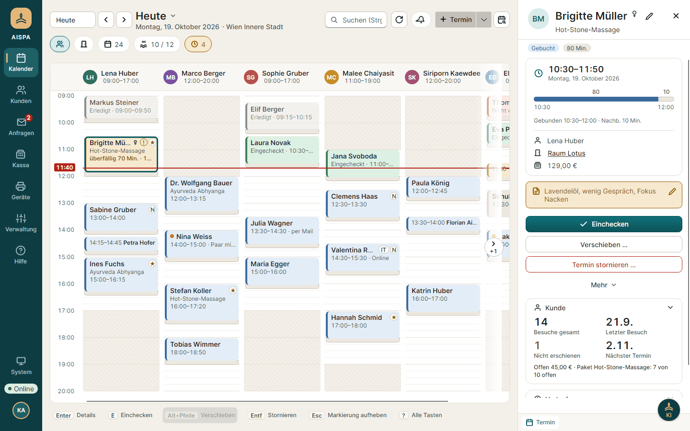
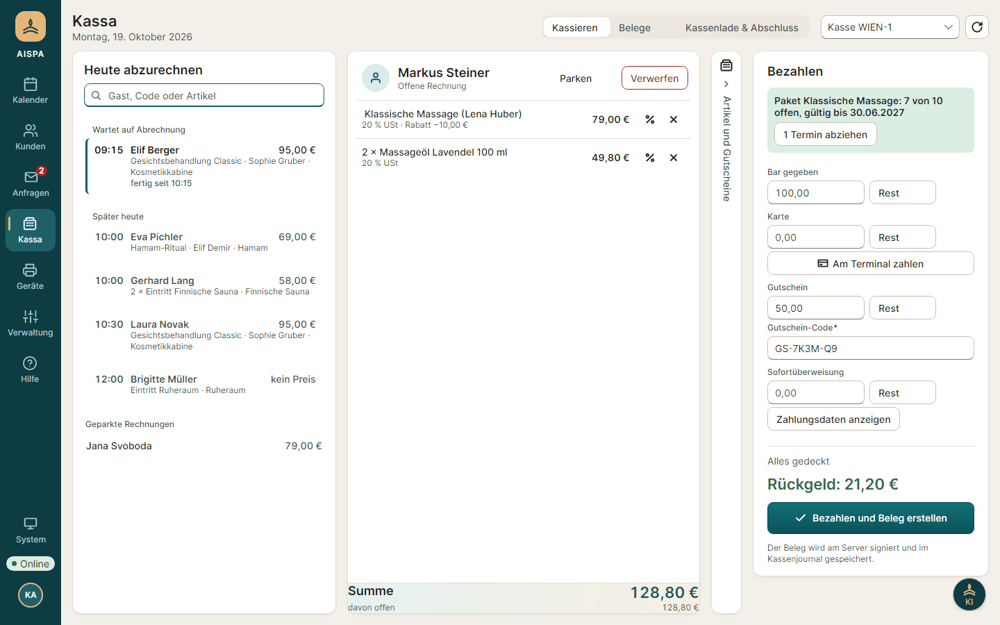
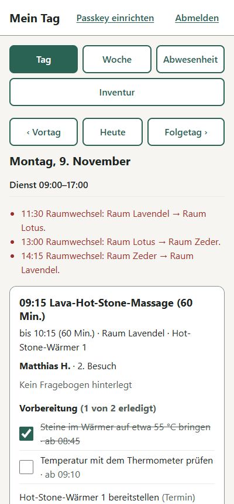

<div align="center">


# AISPA Studio

**Eine Konzeptstudie zur KI-nativen Softwareentwicklung**: eine vollständige Software für Day-Spas,<br>
entworfen, gebaut und geprüft mit KI-Agenten.

[](https://github.com/vompa/aispa-studio/actions/workflows/ci.yml)
[](LICENSE)

[Installation](docs/installation/README.md) ·
[Funktionen](#funktionen) ·
[KI-native Entwicklung](#ki-native-entwicklung) ·
[Dokumentation](#dokumentation) ·
[Sicherheit](SECURITY.md)

</div>

> [!NOTE]
> AISPA Studio ist ein **Prototyp** zum Ansehen, Ausprobieren und Weiterbauen. Die Kassa signiert nur mit einer
> Test-Signatur, und der Server-Betrieb ist noch nicht für den Echtbetrieb freigegeben.



## Worum es geht

AISPA Studio zeigt an einem echten Fachgebiet, wie Software KI-nativ entsteht: Ein Mensch gibt Ziele und Entscheidungen
vor, KI-Agenten (Claude Code) planen, programmieren, testen und dokumentieren. Das Ergebnis ist kein Spielzeug,
sondern eine durchgehende Anwendung für Day-Spas mit bis zu 50 Mitarbeitenden in Österreich, Deutschland und der
Schweiz: Ressourcen-Kalender, Kassa nach RKSV und TSE, Online-Buchung, KI-Terminannahme über alle Kanäle, Vollkosten
je Behandlung und Berichte je Rolle.

Das Repository ist dabei die einzige Quelle: Anforderungen, Entscheidungen, Arbeitsregeln für die Agenten,
Prüfketten und Code liegen nebeneinander und sind nachvollziehbar.

## Funktionen

| Bereich | Was es kann | Windows-App | Web | Handy |
| --- | --- | :---: | :---: | :---: |
| Kalender | Räume, Geräte und Therapeut:innen zugleich planen, ohne Doppelbuchung; Paare, Serien, Warteliste | ✓ | | |
| Kassa | Belege, Gutscheine, Tagesabschluss, Bondrucker und Kartenterminal; RKSV und TSE (im Prototyp Test-Signatur) | ✓ | | |
| Kunden | Kundenkarte, Vorlieben, Anamnese verschlüsselt, auch am Tablet | ✓ | | ✓ |
| Online-Buchung | Kundenbereich mit Konto, Gutscheinkauf und Terminverwaltung | | ✓ | ✓ |
| KI-Terminannahme | Anfragen per Mail, SMS, WhatsApp und Telefon lesen und als Termin vorschlagen; jede KI-Nachricht ist gekennzeichnet | ✓ | | |
| KI-Assistent | Fragen je Rolle beantworten; Pflichtzahlen rechnet nie die KI | ✓ | | |
| Team | Personenkarte, Dienstplan, Abwesenheit, Zeiten und Lohn an einer Stelle | ✓ | | |
| Mein Tag | Plan, nächster Termin, Beginn und Ende melden, Abwesenheit beantragen | | | ✓ |
| Lager und Kosten | Bestände, Verbrauch je Behandlung, Vollkosten pro Behandlung | ✓ | | |
| Berichte | Kennzahlen je Rolle, Exporte für Buchhaltung und Lohn | ✓ | | |
| Dashboard | Tagesüberblick für den Pausenraum, nur lesend, ohne Gesundheitsdaten | | ✓ | |

<p align="center">
  
  &nbsp;
  
</p>

Alle Funktionen mit Einstellungen und Schnittstellen: [Funktionen im Detail](docs/features.md). Für Laien erklärt die
Seite [„Über AISPA Studio“](web/ueber/index.html) (im laufenden Programm unter `/ueber/`) Betriebsarten und
angebundene Dienste.

## Installation

| Betriebsart | Für wen | Anleitung |
| --- | --- | --- |
| **Einzelplatz** | ein Windows-PC, ohne Server und ohne Internet | [Einzelplatz](docs/installation/standalone.md) |
| **Mehrere PCs im Spa** | ein Haupt-PC, weitere PCs im selben Netz | [Weitere PCs verbinden](docs/installation/standalone.md#weitere-pcs-im-spa-verbinden) |
| **Eigener Server** | mehrere Standorte, Online-Buchung, Handy-Apps; mit Docker | [Server](docs/installation/server.md) |

Was ein PC oder Server dafür braucht: [Systemvoraussetzungen](docs/installation/README.md#systemvoraussetzungen).
Die Windows-App liegt nach jedem geprüften Stand im Release
[„Windows-App“](https://github.com/vompa/aispa-studio/releases/tag/windows-app).

Ausprobieren mit Beispiel-Spa, nur mit Docker:

```bash
git clone https://github.com/vompa/aispa-studio.git
cd aispa-studio
docker compose up -d --build
```

Danach `http://localhost:5173/anmelden/` öffnen; die Testkonten stehen in [docs/testdaten.md](docs/testdaten.md).

## KI-native Entwicklung

So entsteht AISPA Studio:

- **Mensch entscheidet, Agenten bauen.** Der Auftraggeber legt Ziele, Prioritäten und fachliche Entscheidungen fest;
  Claude Code plant, schreibt Code und Tests, prüft und dokumentiert.
- **Feste Regeln für die Agenten.** Eine Anleitung für die Agenten legt Sprache, Muster, Grenzen und die Prüfkette
  fest; die Arbeitsweise mit Branches, Pull Requests und Merge steht in [docs/arbeitsweise.md](docs/arbeitsweise.md).
- **Jede Grundsatzentscheidung als ADR.** Über 80 Entscheidungen mit Kontext, Optionen und Begründung in
  [docs/entscheidungen/](docs/entscheidungen/README.md), damit Mensch und Agent dieselbe Grundlage haben.
- **Prüfen statt glauben.** Über 5.600 automatische Tests (API gegen echtes PostgreSQL, Ansichtstests der Windows-App,
  Web), Formatierung, Linter und Bundle-Grenzen laufen in der CI; gemergt wird nur grün.
- **Nachvollziehbar.** Jede Änderung steht mit Detailentscheidungen und Prüfung im
  [PR-Protokoll](docs/umsetzung/pr-protokoll.md), der Stand in [docs/stand-und-offene-punkte.md](docs/stand-und-offene-punkte.md).
- **KI im Produkt mit klaren Grenzen.** Die KI nimmt Termine an und beantwortet Fragen, aber rechnet nie Kasse,
  Steuer oder Berichte für Behörden; Nachrichten nach außen tragen immer einen Hinweis auf die KI.

## Aufbau

| Ordner | Inhalt |
| --- | --- |
| `src/AispaStudio.Api` | Backend: ASP.NET Core 10, OpenAPI 3.1, SignalR, Nachrichten-Queue (Wolverine, dauerhaft in PostgreSQL), Anmeldung per Passkey (ASP.NET Core Identity) |
| `src/AispaStudio.Contracts` | Gemeinsame Datentypen für API, Windows-App und Tests |
| `src/AispaStudio.ServiceDefaults` | Gemeinsame Einstellungen: Health-Checks, OpenTelemetry, Resilienz |
| `src/AispaStudio.AppHost` | .NET Aspire: startet PostgreSQL, API und Web zusammen |
| `src/AispaStudio.Desktop` | Windows-App für die Rezeption (Avalonia) |
| `web` | Web-Apps (Anmelden, Dashboard, Mein Tag, Online-Buchung, Hilfe): React, TypeScript, Vite; API-Typen werden aus dem OpenAPI-Dokument erzeugt |
| `tests` | Integrationstests der API (gegen echtes PostgreSQL im Container) und Tests der Windows-App |

## Entwicklung

Voraussetzungen: .NET SDK 10, Node.js 22, Docker.

```bash
cd web && npm install && cd ..
dotnet run --project src/AispaStudio.AppHost
```

Starten, Beispieldaten, Prüfen wie die CI und Konventionen: [docs/development.md](docs/development.md).

## Dokumentation

| Thema | Wo |
| --- | --- |
| Installation und Systemvoraussetzungen | [docs/installation/](docs/installation/README.md) |
| Funktionen und Einstellungen | [docs/features.md](docs/features.md) |
| Betriebsarten und Module (Referenz) | [docs/installation/operating-modes.md](docs/installation/operating-modes.md) |
| Produkt, Konzepte, Architektur | [docs/](docs/README.md) |
| Entscheidungen (ADRs) | [docs/entscheidungen/](docs/entscheidungen/README.md) |
| Handbuch der App | [web/src/help/content/](web/src/help/content/) |
| Einstieg für die Weiterarbeit | [docs/uebergabe.md](docs/uebergabe.md) |

## Lizenz

[MIT](LICENSE): Jede und jeder darf den Code und die App nutzen, ändern, weitergeben und verkaufen. Fremde Bausteine
behalten ihre eigenen Lizenzen (unter anderem PostgreSQL License, Apache-2.0, BSD, SIL Open Font License für die
Schrift Inter).
