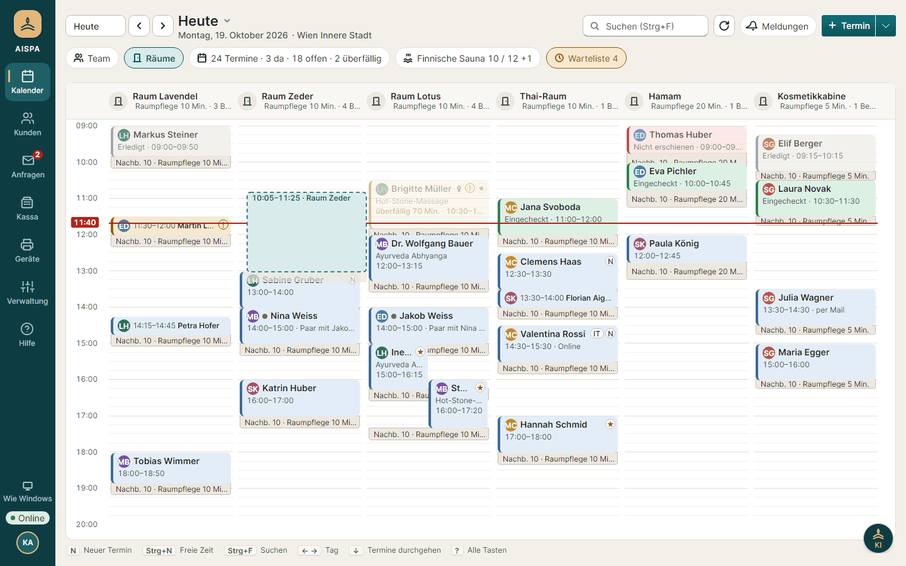
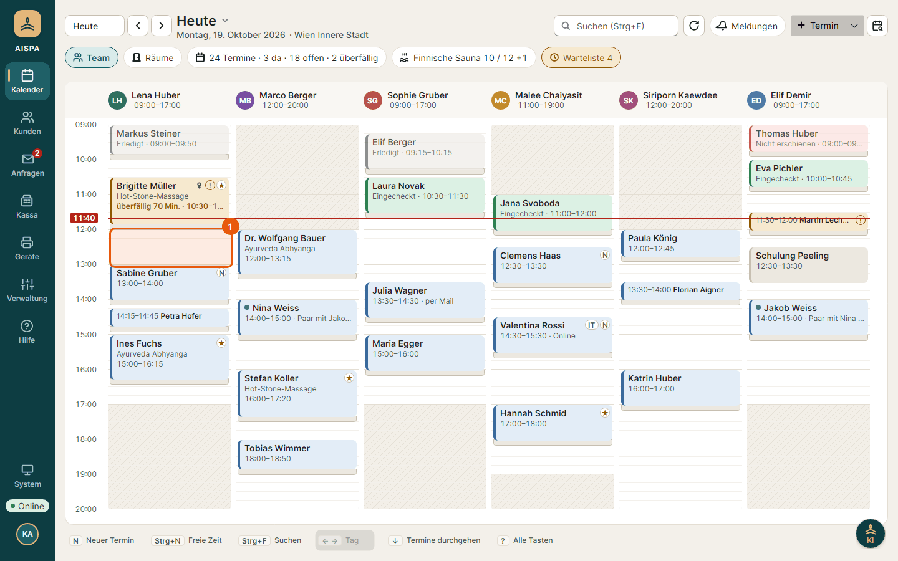

# Hilfe und Handbuch

Eine Quelle und eine Darstellung für die Hilfe in der Windows-App und für die Antworten der KI-Seitenleiste ([ADR 0055](../../../docs/entscheidungen/0055-hilfe-zu-jeder-einstellung-im-repository.md), [ADR 0056](../../../docs/entscheidungen/0056-handbuch-mit-ablaeufen-und-bildern-als-grundlage-der-ki-hilfe.md), [ADR 0079](../../../docs/entscheidungen/0079-eine-hilfe-fuer-windows-app-und-web.md)). Jede Datei unter `content/` ist ein Thema, der Dateiname ist die Kennung.

## Arten von Themen

| Art | Wofür | Kennung |
| --- | --- | --- |
| `seite` | Was eine Seite zeigt und welche Abläufe es dort gibt. Die Seitenleiste zeigt es als „Erklärung zur aktuellen Seite“. | `seite-<seite>`, z. B. `seite-kalender` |
| `ablauf` | Eine Aufgabe Schritt für Schritt, z. B. „Termin verschieben“. Grundlage der Antworten auf „Wie mache ich …?“. | `<bereich>-<aufgabe>`, z. B. `kalender-termin-verschieben` |
| `einstellung` | Alle Einstellungen eines Bereichs, Ziel der Fragezeichen neben den Feldern. Standard ohne Angabe. | `<bereich>`, z. B. `kassa` |

## Aufbau einer Datei

```markdown
---
art: ablauf
bereich: Kalender
oberflaeche: windows-app
rollen: rezeption, leitung
seite: kalender
stichwoerter: verlegen, umbuchen, anderer Tag, ziehen
---
# Termin verschieben

Ein Satz, worum es geht. Die KI zeigt ihn als Kurzantwort.

## Per Ziehen {#ziehen}

1. Termin mit der Maus fassen und an die neue Zeit ziehen.
2. Loslassen. Der Kalender prüft sofort, ob Person und Raum frei sind.



- Hinweise als Aufzählung.
- Verweise auf andere Themen: [Termin stornieren](hilfe:kalender-termin-stornieren), auf einen Abschnitt mit `hilfe:thema#anker`.
```

Kopfangaben (alle optional, Werte durch Kommas getrennt):

- `art`: `seite`, `ablauf` oder `einstellung` (Standard).
- `bereich`: Überschrift, unter der die Übersicht das Thema einordnet.
- `oberflaeche`: `windows-app`, `verwaltung` (Masken der Verwaltung in der Windows-App; der Name stammt aus der Zeit der Team-Oberfläche im Browser), `handy` (Mein Tag).
- `rollen`: `rezeption`, `therapeut`, `leitung` (Standortleitung), `inhaber`. Ohne Angabe für alle. Die Suche reiht passende Rollen vor, versteckt aber nichts.
- `seite`: Kennung der Seite, zu der das Thema gehört (Windows-App: `kalender`, `kunden`, `anfragen`, `kassa`, `geraete`, `abgleich`, `sicherung`, `im-netz`, `netz`, `verwaltung`, `anmeldung`; Handy: `myday`).
- `stichwoerter`: Wörter, mit denen jemand danach fragen würde, auch umgangssprachlich und auf Englisch.

Erlaubtes Markdown: Überschriften `#` bis `####` mit optionalem Anker `{#anker}`, Absätze, Aufzählungen `-`, nummerierte Schritte `1.`, **fett**, `Code`, Links und Bilder in eigener Zeile `` bzw. ``.

Hinweiskästen: ein Absatz, der mit `> Hinweis:`, `> Tipp:` oder `> Achtung:` beginnt, wird ein Kasten mit Symbol und `role="note"` (Hinweis neutral, Tipp grün, Achtung gelb, Werte in [docs/design.md](../../../docs/design.md) 5.30). Weitere Zeilen, die mit `>` beginnen, gehören dazu; eine Leerzeile beendet den Kasten. Die Bildunterschrift ist der Beschreibungstext des Bildes.

Aus der Datei entsteht der Aufbau der Seite: Brotkrumen aus `bereich` (ohne Angabe „Seiten“ bzw. „Einstellungen“) und Titel, „Für: …“ aus `rollen`, „Auf dieser Seite“ aus den `##`-Überschriften (ohne `##` entfällt es), „Verwandte Themen“ aus den `hilfe:`-Links im Text (ohne Links entfällt es). Dafür braucht es nichts weiter als gute Überschriften und Verweise.

## Muster für Abläufe

Ein Ablauf im Muster trägt in den Kopfangaben `aufbau: schritte` und hat immer denselben Aufbau, damit man ihn überfliegen kann und die KI die Teile findet. Die Prüfung steht in `textRules.test.ts` („Muster für Abläufe“) und gilt für jedes Thema mit dieser Angabe.

```markdown
---
art: ablauf
aufbau: schritte
bereich: Kalender
…
---
# Termin buchen

Kurzsatz: was der Ablauf tut, in ein bis zwei Sätzen.

## Voraussetzungen {#voraussetzungen}

- Rolle, Zustand und Verbindung, die der Ablauf braucht.

## Schritte {#schritte}

### 1. Freie Stelle anklicken

Eine Handlung, im Infinitiv. Alternativen („oder“) im selben Absatz nach der Hauptsache.



### 2. Behandlung wählen

…

## Was danach {#was-danach}

Was jetzt zu sehen ist und womit es weitergeht (mit Verweisen `hilfe:`).

## Wenn etwas schiefgeht {#wenn-etwas-schiefgeht}

- Die häufigste Meldung oder Sperre und was dann zu tun ist.
```

- Die ersten vier `##`-Abschnitte heißen genau so und stehen in dieser Reihenfolge; weitere Abschnitte (Sonderwege, Hinweise) folgen danach.
- Jeder Schritt ist eine `###`-Überschrift „`N. Titel`“ (von 1 an, lückenlos) mit genau einem Bild und seinem Alternativtext. Nummerierte Listen taugen dafür nicht: ein Bild beendet die Liste, und die Nummerierung finge neu an. `###` erscheint nicht unter „Auf dieser Seite“.
- Der Alternativtext sagt, was zu sehen ist und was markiert ist („Panel Neuer Termin mit markiertem Knopf Termin buchen“); er ist zugleich die Bildunterschrift.
- Mindestens ein Verweis `hilfe:…` im Text, damit „Verwandte Themen“ nicht leer bleibt.
- Das Zielelement des Schritts ist im Bild markiert (orangefarbener Rahmen mit der Nummer des Schritts). Die Markierung entsteht im Bildtest, nicht im Bild von Hand: `tests/AispaStudio.Desktop.Tests/ViewTests.HelpFlows.cs` und `ViewTests.HelpFlowSteps.cs` haben je Ablauf einen Test (`Handbuch_<Ablauf>`), der Schritt für Schritt `shots.Shot(<Nummer>, <Ziel>)` aufruft; das Bild heißt `<ablauf>-<nummer>`. Findet der Test das Ziel nicht oder liegt es außerhalb des Fensters, schlägt er fehl.
- Umgestellt sind bisher zehn Abläufe von Kalender und Kassa (Termin buchen, verschieben, stornieren, Status setzen, freie Zeit suchen, Paar oder Spa-Tag, Termin kassieren, Beleg stornieren, Tagesabschluss, Gutschein verkaufen); die übrigen Abläufe folgen in einer späteren Runde.

Die Startseite der Hilfe (`HelpIndex.tsx`) zeigt über den Bereichen „Erste Schritte“: je Rolle (Rezeption, Therapeut:in, Leitung, Inhaber:in) die ersten Abläufe (`roleEntries`). Die Rolle aus dem Kontext (`rolle` in der Adresse) steht zuerst. Auf der Hilfe-Seite ist „Erste Schritte“ außerdem die erste Gruppe der Navigation (`firstStepIds`, T-028): mit gewählter Rolle nur deren Einstiege, unter „Alle“ alle je einmal; diese Themen stehen dann nicht noch einmal in ihrem Bereich.

## Bilder

Bilder liegen nach Oberfläche getrennt unter `images/app/` (Windows-App) und `images/web/` (Handy-Seite „Mein Tag“) und werden erzeugt, nicht von Hand gemacht:

- Windows-App (`images/app/`): `scripts/help-images.sh` lässt die Bildtests (`tests/AispaStudio.Desktop.Tests/ViewTests.cs`) mit `AISPA_SCREENSHOTS` laufen und übernimmt jedes Bild, das ein Hilfetext mit `images/app/<name>.png` verwendet. Der Bildname ist der Name im Aufruf `Render("hell", "<name>", …)`.
- Handy-Seite „Mein Tag“ (`images/web/`): `web/scripts/help-images.mjs` meldet sich mit den Testkonten an einer laufenden Umgebung mit Testdaten an und fotografiert die Seiten aus `web/scripts/help-images.json` (Name ohne Ordner und Endung).

Tests in Web und Windows-App schlagen fehl, wenn ein Text ein Bild verwendet, das fehlt, oder auf ein Thema oder einen Anker verweist, den es nicht gibt.

## Darstellung: eine Hilfe-Seite für App und Web

Die Hilfe hat eine einzige Darstellung, die Seite `/help/` (`web/help/index.html`, Einstieg `main.tsx`, Oberfläche `HelpApp.tsx`): links Suche und Themenliste, rechts das Thema mit Ankern und Bildern. Dieselben Bausteine zeichnen die Schublade der Verwaltung (`HelpDrawer.tsx`): Leser (`markdown.ts`), Themen (`topics.ts`), Suche (`search.ts`), Liste (`HelpIndex.tsx`) und Blöcke (`HelpBlocks`).

Das Ziel steht in der Adresse:

| Parameter | Bedeutung |
| --- | --- |
| `thema` | Kennung des Themas (Dateiname ohne `.md`); ohne Angabe die Übersicht |
| `abschnitt` | Anker einer Zwischenüberschrift, nur zusammen mit `thema`; die Seite rollt dorthin und färbt die Überschrift |
| `oberflaeche` | `windows-app`, `verwaltung` oder `handy`; die Suche reiht Themen dieser Oberfläche vor (Standard `verwaltung`) |
| `rolle` | Rollenschlüssel wie `rezeption`; die Suche reiht passende Rollen vor |

Die Windows-App öffnet die Seite im eingebetteten Browser (WebView2): aus dem Ordner `web` neben der App, wenn es ihn gibt (ohne Server und Internet; der Browser ordnet ihn dem virtuellen Host `help.aispa.local` zu und lädt `https://help.aispa.local/help/index.html?…`), sonst vom Server unter `/help/`. Der Build der Seite ist derselbe wie für die übrigen Seiten. Das Budget für die Seite steht in `web/scripts/check-bundles.mjs`.

In der App zeigen die Kurzhinweise in der KI-Seitenleiste (`HelpTeaser`) nur Titel und ersten Satz; der Knopf „In der Hilfe öffnen“ führt zur Seite.

## Schreibregeln

- Schritte im Infinitiv („Termin anklicken“, „Auf **Kassieren** klicken“), Knöpfe und Felder fett und genau so geschrieben wie in der Oberfläche.
- Nur beschreiben, was die Software heute tut. Ändert sich ein Ablauf, ist der Hilfetext Teil derselben Änderung.
- Rechte nennen, wenn nicht jede Rolle den Ablauf ausführen darf.
- Keine Zahlen erfinden; Beispiele mit runden Werten.
